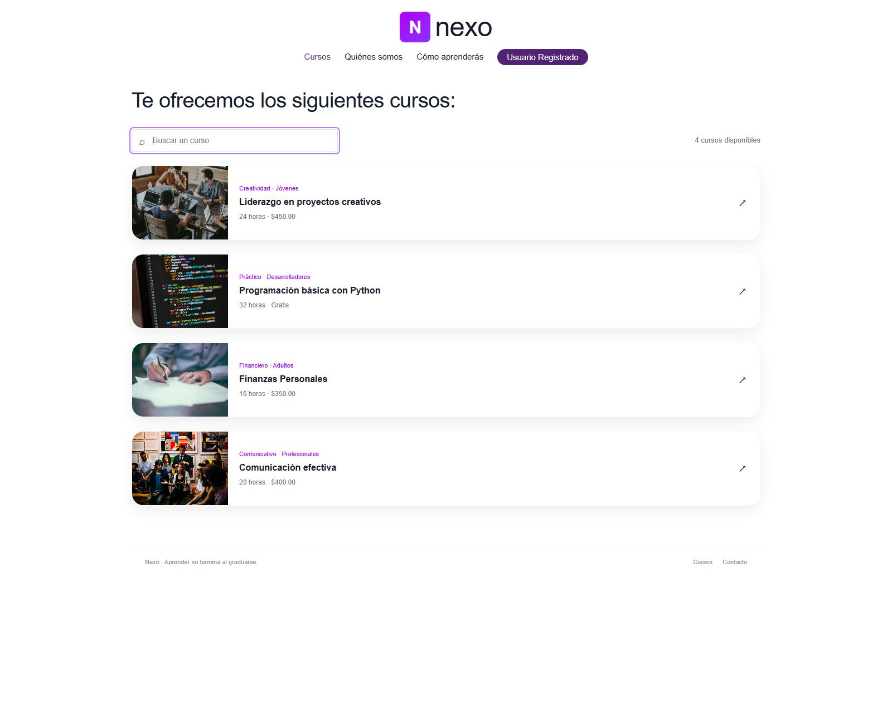
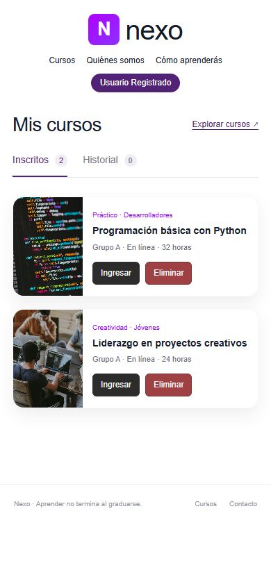

# Validación de la entrega

Comprobaciones realizadas el 16 de noviembre de 2026, con PHP 8.4.27, PDO SQLite, Node para pruebas HTTP y navegador Chromium integrado. Se usaron únicamente cuentas y datos de demostración.

## Resultados

| Comprobación | Resultado |
| --- | --- |
| Sintaxis de los archivos PHP | Sin errores |
| Sintaxis JavaScript | Sin errores |
| `php tests/run.php` | 31 comprobaciones correctas en base temporal |
| `node tests/http.mjs` | Correcto: acceso, CSRF, métodos, rutas, 11 páginas, recursos y aislamiento de archivos privados |
| Iniciador Windows | Ejecutado correctamente con PHP portable y puerto alternativo 8766; prueba HTTP también correcta |
| Consola del navegador durante el recorrido | Sin errores JavaScript capturados |
| Vista móvil de Mis cursos | Verificada a 390 × 844, sin desbordamiento horizontal |
| Formulario de inscripción móvil | Verificado; columnas apiladas y controles legibles |
| Vista de escritorio | Encabezado, colores, tarjetas y jerarquía comprobados contra los bosquejos |

## Flujos comprobados

En el navegador: inicio de sesión con la cuenta demo, visualización de Mis cursos, entrada al aula y avance entre módulos, selección de grupo, inscripción, confirmación de éxito, cancelación del diálogo de baja, baja efectiva, consulta del historial, reinscripción, búsqueda y mensaje sin resultados.

En las pruebas del servidor: rechazo sin sesión, rechazo por rol administrador, cambio de precio antes de confirmar, alta y pago atómicos, bloqueo de dos grupos del mismo curso, cupo lleno, baja de un tercero, protección del aula, fecha de baja, baja repetida, liberación de cupo, reinscripción de la misma fila, conservación de importes históricos, grupos inactivos, ausencia de filas parciales, integridad curso/grupo, registro sin escalamiento de rol, hash de contraseña, email duplicado, credenciales incorrectas, token de un solo uso, contraseña anterior inválida, recuperación sin revelar cuentas en el mensaje, revocación de sesión al cambiar contraseña y desactivación de usuario.

Las pruebas HTTP confirmaron que `.env`, `src/`, `config/`, `storage/` y `database/` no se sirven desde la raíz pública. El router devuelve 404 para rutas que no existen y archivos ocultos.

## Alcance de la verificación

MySQL y Supabase se entregan como esquemas y conexiones preparados. No se ejecutaron contra un servidor real porque no se proporcionaron host, base ni credenciales. Los bloqueos SQL se implementaron para ambos motores, pero no se realizó una prueba de carga concurrente sobre ellos. En este equipo tampoco estuvo disponible la extensión PostgreSQL para una prueba de conexión.

No se enviaron correos ni se efectuaron cobros. El proveedor de correo, la pasarela de pago, el material real y los certificados siguen siendo puntos de integración del equipo. La demo es local y usa SQLite; no se presenta como una instalación de MySQL/Supabase ya conectada ni como un servicio publicado.

## Capturas

Catálogo de escritorio:

Mis cursos en móvil:

